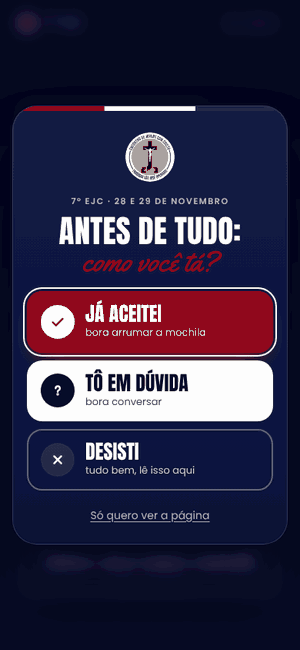
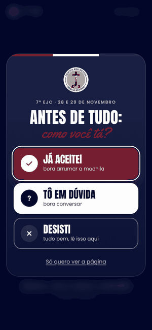

# ✝️ ejc-sao-jose-operario-parish

**Site do 7º EJC (Encontro de Jovens com Cristo) da Paróquia São José Operário**, em Munhoz Júnior, Osasco, nos dias **28 e 29 de novembro de 2026**. Um pop-up pergunta **"como você tá?"** e mostra uma página para quem já aceitou, para quem está em dúvida e para quem pensou em desistir.


---

## 📸 Fluxos principais

<!--  -->
<!--  -->
<!--  -->

> GIFs em breve.

---

## 🚀 Funcionalidades

| Página | Endereço | O que tem |
| --- | --- | --- |
| ✅ Já aceitei | `#aceitei` | Contagem regressiva, tema, música, santo padroeiro, checklist do que levar, avisos e botão de salvar na agenda |
| 🤔 Tô em dúvida | `#duvida` | Respostas para as dúvidas mais comuns, conversa no WhatsApp e botão "Decidi: eu vou!" |
| 🚪 Desisti | `#desisti` | Resposta para cada motivo, convite para 2027 e botão "Mudei de ideia, eu vou!" |

- A resposta do pop-up, o checklist e o nome ficam salvos no aparelho
- As mensagens do WhatsApp já vão com o nome e o contexto da pessoa
- Depois de **21/11** os botões "eu vou" e os contatos de WhatsApp somem sozinhos

---

## ⚙️ Como executar

Não tem dependência nem build: é só abrir o `index.html` no navegador.

Para publicar: **Settings → Pages → Deploy from a branch → `main` / `(root)`**.

### 🔧 Configurações (`js/main.js`)

| Variável | O que faz |
| --- | --- |
| `WA_NUMBER` | Número do WhatsApp que recebe as mensagens |
| `DEADLINE` | Prazo das exceções (21/11/2026 às 23h59) |
| `target` | Data da contagem regressiva |

> [!TIP]
> Para ver como o site fica depois do prazo, abra com `?prazo=encerrado`, por exemplo `index.html?prazo=encerrado#duvida`.

---

## 📁 Estrutura

```
├── index.html     → estrutura das páginas e do pop-up
├── css/style.css  → estilos
├── js/main.js     → comportamento
└── assets/        → logo, brasão e foto do Carlo Acutis
```

---

## 🤝 Créditos

| Área | Responsável |
| --- | --- |
| 💻 Desenvolvimento e design | [Julia Rodrigues](https://github.com/lunajulia107) |
| ⛪ Realização | Paróquia São José Operário |

## 📄 Licença

Este projeto está sob a licença **MIT**.
